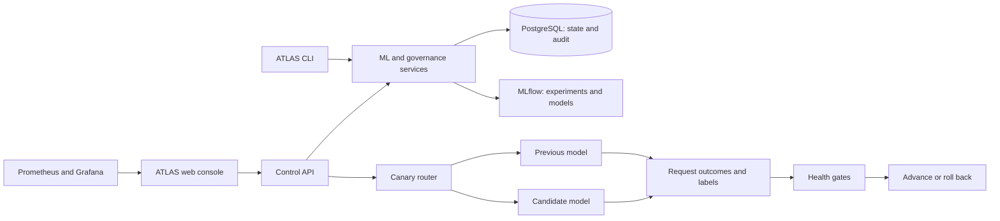

# ATLAS

**A local-first platform for monitoring, investigating, improving, and safely deploying machine-learning models.**

A prediction API can be online while its model is becoming less accurate. ATLAS helps
an operator spot that problem, understand its cause, train a replacement, review the
evidence, and introduce the new version gradually—with a way to roll back.

The platform combines a Next.js web console, Python ML services, PostgreSQL, MLflow,
Prometheus, and Grafana. It uses reproducible synthetic datasets and runs locally;
no paid AI API or cloud account is required.

[Getting started](#getting-started) · [How it works](#how-it-works) · [Web console](#web-console) · [Validation](#validation-and-current-limits) · [Documentation](#documentation)

## What you can do

| Capability | What it means |
| --- | --- |
| Train and track models | Compare experiments, metrics, datasets, and saved model versions. |
| Monitor reliability | Detect changing input data, missing values, prediction drift, and falling model quality. |
| Investigate incidents | Review recorded evidence to distinguish a model problem from an upstream data problem. |
| Retrain with safeguards | Validate data, train a candidate, compare quality and latency, and require approval. |
| Release gradually | Route 10%, 25%, 50%, then 100% of traffic to a candidate only when measured health passes. |
| Recover and audit | Restore the previous version and retain a history of decisions and deployment changes. |

**Example:** an energy-demand model starts making larger errors. ATLAS records the
signal, links it to an investigation, and supports a reviewed retraining request.
A replacement must pass validation before approval. During rollout, new traffic
and labels determine whether to advance or roll back. Higher automation levels are
optional; the default keeps progression under operator control.

## How it works



- **PostgreSQL** records model lineage, incidents, approvals, routing, and audit events.
- **MLflow** tracks experiments and stores versioned model artifacts.
- **The control API** serves the console and coordinates governed operations.
- **The router** sends real requests to retained versions and measures their outcomes.
- **Health gates** require fresh evidence for each traffic stage. Missing evidence blocks advancement.

A *candidate* is a proposed version. A *champion* is the approved model of record.
A *canary* receives a small share of traffic before a wider release. Registering or
promoting a model alone does not automatically move serving traffic.

## Three example workloads

| Workload | ML task | Failure scenario |
| --- | --- | --- |
| Fraud detection | Binary classification | Transaction behavior changes and recall falls. |
| Predictive maintenance | Binary classification | Sensor corruption or missing values affect input quality. |
| Energy demand | Regression with chronological validation | Demand patterns change and forecast error rises. |

All three use the same platform services. Their metrics are measured on held-out
synthetic data; they are demonstrations, not claims of real-world model performance.

## Getting started

### Prerequisites

- Python **3.11 or 3.12** and Git.
- Node.js **24** and npm for the web console.
- Either a working Docker engine with Compose, **or** Windows with PostgreSQL 17/18 binaries installed.
- Internet access for the initial dependency and container downloads.

Run commands from the repository root. The examples below use Windows PowerShell.

### 1. Install the project

```powershell
git clone https://github.com/kailash0001/ATLAS.git
cd ATLAS
py -3.11 -m venv .venv
.\.venv\Scripts\python.exe -m pip install -c requirements.lock -e '.[dev,reliability]'
```

### 2. Start PostgreSQL and MLflow

Choose **one** infrastructure mode.

**Option A — Docker Compose**

```powershell
# For a fresh checkout only; preserve an existing .env.
Copy-Item .env.example .env
.\.venv\Scripts\python.exe scripts/dev.py infra-up
```

**Option B — native Windows, without Docker**

```powershell
# Do not copy .env.example for this mode. The helper creates native settings.
.\.venv\Scripts\python.exe scripts/native_infra.py up
```

The native helper creates a separate PostgreSQL cluster under `.local/postgres`.
It does not modify existing Windows database services. If binaries are not found,
set `AEGIS_PG_BIN` to the installed PostgreSQL `bin` directory.
Do not mix the two modes' database settings or ports.

### 3. Initialize and train

```powershell
.\.venv\Scripts\atlas.exe db upgrade
.\.venv\Scripts\atlas.exe doctor
.\.venv\Scripts\atlas.exe train --config configs/models/fraud.yaml
.\.venv\Scripts\atlas.exe train --config configs/models/maintenance.yaml
.\.venv\Scripts\atlas.exe train --config configs/models/energy.yaml
.\.venv\Scripts\atlas.exe models list
```

Training generates reproducible datasets, records experiments, and registers candidate
versions. It does not silently approve or deploy them. A fresh checkout starts with
an empty database; the validation runs from the original development machine are not bundled.

### 4. Build and open ATLAS

```powershell
cd apps/console
npm ci
npm run build
cd ../..
.\.venv\Scripts\python.exe scripts/native_console.py up
```

Open **[http://127.0.0.1:3100](http://127.0.0.1:3100)**.

| Local demo login | Value |
| --- | --- |
| Username | `atlas` |
| Password | `atlas_local` |

The landing page includes local service access details and a scroll-driven 3D
illustration of the ML lifecycle. Login uses a signed, expiring session. This shared
account is intentionally for local development. The launcher generates an operator
token under ignored `.local/`; that token is not sent to the browser.

On Linux/macOS, create the environment with `python3.11 -m venv .venv`, activate it
with `source .venv/bin/activate`, use the Compose infrastructure option, and replace
`.\.venv\Scripts\python.exe` / `atlas.exe` with `python` / `atlas`.

## Web console

| Workspace | Purpose |
| --- | --- |
| Overview | Fleet health, incidents, throughput, and recent activity. |
| Models | Model versions, metrics, artifacts, and dataset lineage. |
| Deployments | Traffic stages, measured health, promotion, and rollback. |
| Incidents | Signals, investigations, acknowledgement, and resolution. |
| Datasets | Dataset versions, fingerprints, and manifests. |
| Pipelines | Retraining stages, validation gates, and optional Airflow dispatch. |
| Monitoring | Real telemetry and rollout health. |
| Governance | Candidate review, approval, and deployment eligibility. |
| Audit | Recorded operator and automation actions. |
| Settings | Environment, integrations, and rollout policy. |

The console preserves unknown and unavailable states. It does not manufacture charts
when telemetry is missing. Use **Ctrl+K** to jump between workspaces.

### Local service addresses

| Service | Native Windows | Compose | Development access |
| --- | --- | --- | --- |
| ATLAS console | 3100 | 3100 (host process) | `atlas / atlas_local` |
| Control API docs | 8100/docs | 8100/docs (host process) | Mutations require server-managed token |
| MLflow | 55000 | 5000 | No local login |
| PostgreSQL | 55432 | 5432 | Database `aegis`, user/password `aegis / aegis_local` |
| Inference API docs | 8000/docs | 8000/docs | Start serving separately |
| Prometheus | 9090 | 9090 | No local login |
| Grafana | 3000 | 3000 | `aegis / aegis_local` |

All addresses use localhost. Monitoring is optional and is not started by the console launcher.
See [serving and monitoring setup](docs/deployment.md) for champion selection and startup.
The Phase 2 inference endpoint and Phase 6 canary router are separate serving paths;
use `/api/v1/predict/{model}` on the control API for canary traffic.

### Stop local services

```powershell
.\.venv\Scripts\python.exe scripts/native_console.py down
# Native infrastructure mode:
.\.venv\Scripts\python.exe scripts/native_infra.py down
# Or Compose infrastructure mode:
.\.venv\Scripts\python.exe scripts/dev.py infra-down
```

Stopping preserves data. Native monitoring, if started, has its own
`python scripts/native_observability.py down` command.

## Safe rollout and automation

The default rollout policy requires approved, eligible candidates, fresh test
verification, adequate observations and labels, acceptable error rate and latency,
and workload-specific quality thresholds. Each stage collects new evidence.
Manual rollback and policy-driven automatic rollback retain the previous artifact.

```text
atlas models compare fraud-detector
atlas remediation --help
atlas deployments --help
```

Follow [the complete demonstration](docs/demo.md) for actual review and rollout commands.
[Rollout operations](docs/rollouts.md) explains autonomy levels and native versus
Kubernetes execution. Optional Airflow orchestration is described in
[retraining and approval](docs/remediation.md).

## Repository map

```text
apps/console/           Next.js landing page, login, and operations UI
apps/control_api/       FastAPI control-plane API
apps/inference/         Original governed inference service
apps/runtime/           Version-specific Kubernetes inference runtime
aegis/                  Shared ML, reliability, governance, routing, database, and CLI code
configs/                Workload definitions and reviewed quality/rollout policies
migrations/             Versioned database schema
dags/                   Airflow retraining workflow
infrastructure/         Containers, kind/Kubernetes, monitoring configuration
scripts/                Setup, service lifecycle, traffic, and demonstration helpers
tests/                  Unit and integration tests
docs/                   Setup, architecture, operations, decisions, and validation reports
```

**Naming:** the product is ATLAS. The internal `aegis` Python package, `AEGIS_*`
environment variables, and development database names are retained for compatibility.
Both `atlas` and `aegis` CLI entry points work.

## Validation and current limits

The final local validation recorded **107 passing backend tests** (91 unit + 16
integration), a successful frontend production build and TypeScript check, browser
checks on desktop/mobile, and login/session HTTP checks. A real synthetic HTTP
exercise sent **1,600 requests** through 10/25/50/100% rollout stages, promoted the
candidate, rolled back, and verified that the previous version served again.
See [the evidence and exact scope](docs/phase-6-report.md).

```powershell
.\.venv\Scripts\python.exe scripts/dev.py lint
.\.venv\Scripts\python.exe scripts/dev.py test
cd apps/console
npm run typecheck
npm run build
# With local test services running:
npm test
```

PostgreSQL integration tests require `AEGIS_TEST_POSTGRES_URL` pointing to a local
role allowed to create temporary test databases; otherwise those cases are skipped.
The frontend Playwright suite is configured in CI. GitHub Actions also defines Python,
container, and kind checks; an authored workflow is not a claim of a successful remote run.

Current boundaries:

- Local development identity and synthetic workloads; no production SSO or multi-tenant access model.
- Native canary behavior is verified. Kubernetes manifests and runtime provisioning are implemented,
  but local kind execution was blocked by an unavailable Docker engine and missing kind.
- Airflow runtime validation also depends on Docker. Missing integrations remain visible.
- KServe and shadow traffic are optional future adapters; Kubernetes uses standard Deployments/Services.
- The router is a local single-process service. Production availability, ingress, and shared storage need further work.

The six implementation phases cover ML foundations, serving, reliability,
investigation, retraining, and the control plane/safe rollout. Runtime limitations
above remain explicit rather than being marked as completed verification.

## Documentation

- [Local setup and troubleshooting](docs/local-development.md)
- [Architecture and database schema](docs/architecture.md)
- [Model lifecycle and dataset provenance](docs/mlops-lifecycle.md)
- [ATLAS console and login](docs/control-plane.md)
- [Serving and monitoring startup](docs/deployment.md)
- [Reliability and fault injection](docs/reliability.md)
- [Investigations and energy forecasting](docs/investigations.md)
- [Retraining, Airflow, gates, and approvals](docs/remediation.md)
- [Canary rollout and rollback](docs/rollouts.md)
- [End-to-end demonstration](docs/demo.md)
- [Final validation report](docs/phase-6-report.md)

Generated datasets, model artifacts, databases, logs, `.env`, and operator tokens
are excluded from Git. Only intentional local demo credentials appear in source.
