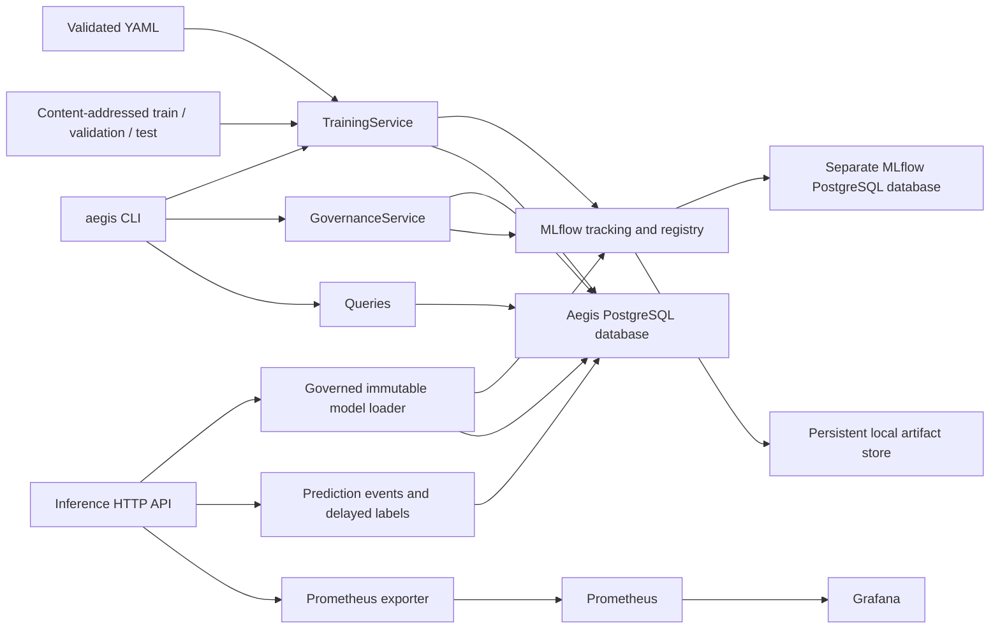

# Architecture through Phase 4

AegisML is the platform; models are managed workloads. Phase 1 implements the
reproducibility and governance foundation. The CLI calls Python services that a
future control API can reuse. Phase 2 adds a FastAPI serving adapter over the governed
registry and durable evidence. Phase 3 adds policy-driven reliability and incidents
for fraud and predictive maintenance. The custom control-plane frontend remains planned.

## Module boundaries

| Module | Responsibility |
| --- | --- |
| `aegis/core` | Settings, strict Pydantic configuration, errors, JSON logging |
| `aegis/data` | Seeded synthetic generation, split isolation, fingerprints, integrity checks |
| `aegis/training` | Scikit-learn preprocessing, evaluation, MLflow tracking, registration |
| `aegis/registry` | Read models, comparisons, state transitions, audit and alias synchronization |
| `aegis/db` | Typed SQLAlchemy entities and connection factories |
| `aegis/cli` | Thin command adapter; JSON output for scripting |
| `aegis/serving` | Governed loading, inference, durable events, observed metrics |
| `apps/inference` | HTTP routes, correlation middleware, error contracts |
| `migrations` | Explicit Alembic schema revisions |
| `infrastructure` | Local Compose services and artifact storage |

## Database schema

| Table | Key fields and relationships |
| --- | --- |
| `models` | UUID, unique name and registry name, owner, use case, risk, environment, sync_pending, created_at |
| `datasets` | UUID, unique name, source |
| `dataset_versions` | Dataset FK, unique SHA-256 fingerprint, immutable manifest, created_at |
| `training_runs` | Model and dataset-version FKs, unique MLflow run ID, experiment ID, algorithm, full config, revision, status, metrics, error type, timestamps |
| `model_versions` | Model and unique training-run FKs, registry version, status, framework, model URI, feature schema, created_at |
| `audit_events` | UUID, timestamp, actor, action, resource type/ID, JSON metadata |
| `prediction_events` | UUID, model-version FK, request ID, features, probability/class/threshold, inference duration, timestamps, optional actual label |
| `reliability_reports` | UUID, model-version FK, unique evidence fingerprint, severity, profiles/policy/lineage/findings JSON, timestamp |
| `incidents` | UUID, model-version FK, type, feature, severity, lifecycle status, first/latest report FKs, occurrences and timestamps |

Foreign keys protect lineage. `(model_id, version)` is unique. A partial unique
index enforces at most one champion per model. Status check constraints prevent
invalid persisted states. Foreign keys and common query fields are indexed.

MLflow owns experiments, detailed run artifacts, model signatures and the artifact
registry; Aegis stores their IDs rather than implementing another experiment store.
Deployments and deployment history are explicitly unavailable until later phases.
One Aegis database belongs to one environment; registry names include that environment.

## Authority and failure semantics

PostgreSQL is authoritative for governance. A transition and its audit events commit
in one SQL transaction. Transitions lock the model row. Champion replacement archives
the previous champion before selecting the next; the unique index adds protection.

The transaction marks `sync_pending=true`. The registry sync operation takes the same
row lock, publishes the desired `champion` and latest eligible `candidate` aliases and
version tags, then clears the flag. Remote failure leaves the decision and pending flag
intact. `aegis models sync NAME` retries idempotently. This is recoverable eventual
consistency, not a distributed transaction. An external MLflow consumer can see a
partially synchronized state; the Phase 2 loader must check Aegis sync status.

Training creates a RUNNING platform record before tracking work and marks failures.
Runs link configuration, dataset hashes, Git revision (including dirty/uncommitted
state), package versions and MLflow IDs. A process killed abruptly may leave RUNNING
records. A registry write followed by SQL failure can leave an ungoverned MLflow version;
inspect its `aegis.run_id` tag and failed platform run. It is never eligible for promotion.
Automatic orphan cleanup and crash reconciliation are deferred to orchestration work.

## Local boundaries

These are single-developer local services with explicit development credentials and
loopback-only bindings, not a multi-tenant production deployment. Actor identity is
configured, not authenticated. Audit history is application-level, not tamper-proof
against a database administrator. Training calls run sequentially within a CLI process;
there is no job queue. PostgreSQL is required for concurrent governance; SQLite is
used only for fast, isolated tests.

## Phase 2 serving boundary

The service loads the exact governed version and checks signature, threshold and
dataset lineage. New predictions require matching governance and persist an event
before success. Delayed labels are row-locked, idempotent and audited. The additive
`0002` migration preserves existing model/run records.

Business metrics come from persisted evidence for the loaded version in a configurable
window. Prometheus stores time series; SQL stores events/lineage, not every metric
sample. HTTP histograms include persistence cost and use bounded labels. The read-only
model/monitoring endpoints expose actual state for future control-plane use.

See [serving](serving.md), [monitoring](monitoring.md), and
[ADR 001](adr/001-phase-1-storage-and-governance.md) for semantics and limits.

## Phase 3 reliability boundary

`reliability.workload` loads the model's immutable validation reference, evaluates
batch readings or stored serving events, verifies model/run metadata, and archives
input CSVs by content hash. `analysis` computes profiles, checks, distances and
performance evidence; validated policies classify severity and eligibility.
`ReliabilityService` transactionally records reports, incident observations and audit.
Both report upserts and incident transitions lock the same model-version row.

Migration `0003` adds evidence and incidents while preserving existing records.
The serving loader accepts both fraud and maintenance contracts and requires the new
revision. Existing inference processes must restart after migrating. Raw sensor
corruption is analyzed before model scoring and leads to source investigation with
retraining eligibility disabled. See [reliability operations](reliability.md).

## Phase 4 investigation boundary

`InvestigationService` locks the incident and snapshots its immutable latest report,
lineage, policy, observed findings and bounded history. Deterministic rules classify
UPSTREAM_SYSTEM, DEPLOYMENT, INFRASTRUCTURE, DATA, MODEL or UNKNOWN with cited support.
Correlated categories are retained; unavailable telemetry is explicitly unknown.
Migration `0004` adds `investigations` and `investigation_explanations`, with foreign
keys, category/status checks and a unique incident/report/rules fingerprint.

The optional localhost Ollama adapter can order permitted evidence and next-step IDs.
A deterministic renderer supplies every metric and sentence. Its result is separate
from the immutable rule conclusion; neither component executes operational actions.
Energy regression reuses governed training and reliability with chronological data
splits, causal known lags, MAPE/MAE/RMSE and hourly error evidence.
See [investigation operations](investigations.md).

## Phase 5 remediation boundary

Migration `0005` adds source-bound test verification, immutable request configuration,
workflow states, evaluation evidence and managed training-attempt lineage. Airflow
schedules three CLI stages; PostgreSQL owns stage claims, audit and approval state.
Each stage revalidates evidence and datasets. Both baseline and candidate are measured
on the same validation dataset before an explicit review can grant eligibility.

`RetrainingAttempt` links a request to its training run before artifact creation.
Governance checks this link even if interruption prevents attaching the candidate to
the request. Request approval and model promotion lock the model before the request
to preserve a consistent lock order. Failed and stale requests cannot authorize
managed promotion. Automatic recovery of abruptly killed workers remains deferred.

The source verification hash covers Python/YAML in the application, tests, workload
configs, migrations and DAGs, plus dependency declarations/lock. It is local evidence,
not a signed supply-chain attestation. Database administrators remain trusted.
See [remediation operations](remediation.md) for freshness, policy and rollout boundaries.
